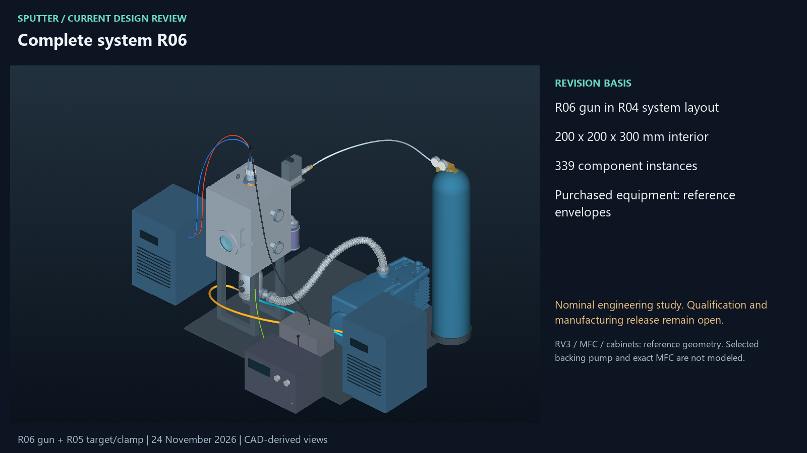

# Sputter deposition system

A compact magnetron sputtering system designed for reliable thin-film deposition, straightforward maintenance, and use in teaching.

This project builds on our experience with an earlier lab-built sputtering system. That system highlighted several challenges: exposed live components, improvised target cooling, difficult sealing and target replacement, and inconsistent vacuum performance. Sputter v2 aims to address these through a modular gun, a compact chamber with a hinged loading door, and integrated cooling, vacuum, gas, and RF subsystems.

It is also an attempt to bridge gaps across many existing open sputtering builds, drawing on their strengths while working toward a more complete, maintainable and well-documented system.

**Current stage:** CAD, engineering studies, and procurement planning are documented. Final design review, procurement, fabrication, and commissioning remain ahead.

## Safety first

Sputtering systems combine high voltage, RF power, vacuum, compressed gas and water cooling. Learn from an experienced operator and follow your lab's procedures before using one. The videos and CAD here explain the project; they are not operating instructions.

- **Power:** keep live parts enclosed and exposed metal properly grounded. Switch off and isolate power before opening or adjusting electrical hardware; stored charge can remain after shutdown. Do not bypass interlocks.
- **Vacuum:** use vacuum-rated chambers, windows and fittings. Keep clear of damaged glass, and vent slowly before opening a chamber. Follow the pump manufacturer's startup, shutdown and venting instructions.
- **Gas:** secure cylinders, use the correct regulator and check for leaks. Argon can displace oxygen, so use it in a suitably ventilated space.
- **Cooling and moving parts:** check cooling flow and leaks before applying power. Keep water away from electrics, and keep hands clear of hot parts, strong magnets and moving mechanisms.
- **When unsure, stop:** do not work alone during initial testing. Know how to isolate power and gas, and have the setup reviewed before energizing it.

## New to sputtering? Start here

Sputtering deposits a thin coating onto a sample. Energetic argon ions strike a source material (the **target**), releasing atoms that collect on the surface being coated (the **substrate**).

Watch [Sputtering: what is it and how does sputter deposition work?](https://www.youtube.com/watch?v=-lm0Y3Hyw-Q), an introductory animation by Korvus Technology. Then explore our own animations below.

### Start with our animations

1. **[Explore the complete system — 3:59](media/assembly-walkthrough/Sputter%20R06%20-%20silent%204%20minute%20walkthrough%20v2.mp4).** The corrected R06 assembly and operating-cycle tour, including the complete shutter motion.
2. **[Explore the gun — 3:53](media/gun-complete-walkthrough/R06%20sputter%20gun%20-%20slower%20compact%20walkthrough.mp4).** The current target, cooling, magnetic circuit, insulation and RF connections. Both videos are silent; see [system architecture and CAD](system-architecture-and-cad/README.md) for the essential rendered views, explanations and downloads.

### See working sputtering builds

Our team has built and operated an earlier sputtering system; this repository documents the v2 design through CAD, a bill of materials (BOM), engineering studies and animations. Start with our earlier build, then explore the other documented builds that helped inspire our work:

| Creator | Watch |
|---|---|
| **HackerFab IITB** | [Our old sputter](https://www.youtube.com/watch?v=UWHMm4Qjpmo&t=1329s), starting at 22:09 |
| **Advanced Tinkering** | [Metal coating by plasma bombardment](https://www.youtube.com/watch?v=el17fof1OAY) · [Magnetron design breakdown](https://www.youtube.com/watch?v=MslftqA7LYw), the reference for our gun reconstruction |
| **The Thought Emporium** | [Coat anything in metal: magnetron sputtering machine build](https://www.youtube.com/watch?v=aljbjJbfghs) |
| **Applied Science** | [Intro to sputtering: creating clear, conductive coatings](https://www.youtube.com/watch?v=9OEz_e9C4KM) |

For another documented lab build, see [CMU HackerFab's RF sputtering system](https://docs.hackerfab.org/home/fab-toolkit/rf-sputtering), including its parts list, build instructions and testing results.

## New to building vacuum systems? Start here

Sam Zeloof's introductions are a useful starting point for understanding the vacuum hardware around a sputtering source:

1. **[High Vacuum Chamber Basics, Part 1](https://www.youtube.com/watch?v=iZ9ieSHOZsg)**
2. **[High Vacuum Chamber Basics, Part 2 — Atmospheric to 1e-6 Torr Pumpdown Procedure](https://www.youtube.com/watch?v=vOBUx9HtMi4)**

## Project status

The end-to-end design is ready and documented. A component list has been prepared, with each part assigned a procurement route:

| Route | Status |
|---|---|
| **Custom order** | Vendors identified for specialized parts; CAD models and specifications are ready to send after final review. |
| **Procure online** | Purchase links identified, including suppliers in India and the US. |
| **Procure locally** | Parts identified for offline sourcing. |

The design files and [procurement list](procurement/README.md) are available in this repository.

**Next steps:** review the entire design and component selection part by part, then start the procurement and manufacturing process.

## Explore the project

| Page | What you will find |
|---|---|
| [System architecture and CAD](system-architecture-and-cad/README.md) | How the system fits together, essential renders, current videos and design files |
| [Parts and procurement](procurement/README.md) | Component selections, sourcing routes, workbook and planning budget |
| [Engineering and simulations](docs/engineering.md) | Design goals, decisions, calculations and supporting evidence |
| [Review before building](docs/verification.md) | The part-by-part review and outstanding checks before procurement, manufacturing and operation |
| [Reproducing the work](docs/reproducibility.md) | How to obtain the files, inspect the scripts and validate the repository |

The v2 design is documented; final review, manufacturing and commissioning remain ahead. CAD checks and simulations support the design but do not establish measured machine performance.

No open-source license has been assigned. Third-party supplier CAD, drawings, manuals and the original reconstruction references retain their respective rights. See [attribution and source handling](docs/sources.md).
