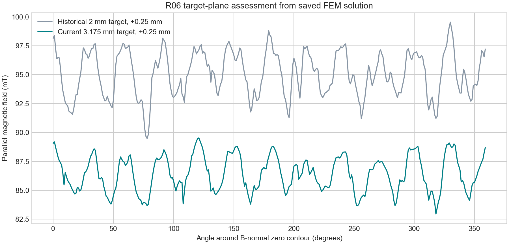

# Simulation and calculation evidence

## What exists

| Work | Evidence and scope | Current applicability |
|---|---|---|
| 3D nonlinear magnetostatic FEM | Meshes, code, B-H data, solved fields, metrics, analytical comparison | Original target 2 mm; current plane assessed separately |
| Mesh refinement | Ring mean change about 0.44% | Numerical verification for original sampling region |
| Air-domain/remesh check | Coarse ring mean change about 0.11% | Numerical check, not full hardware uncertainty |
| Independent analytical comparison | Unit-permeability magnets vs Magpylib, 9,600 sample points; refined vector L2 error 2.33% | Solver verification without steel |
| Steel curve sensitivity | Reference H values scaled 0.5× / 2× | Narrow assumed-material sensitivity, not a bound for arbitrary steel |
| Target spacing sensitivity | Nonmagnetic target plane variants in saved results | Historical discrete samples; new 3.175 mm plane below |
| Current target resampling | [Current results](../simulations/current-target-r06/README.md) | 3.175 mm target, 0.25 mm above face |
| Geometry/interference | R05/R06 Boolean checks and native export/reference checks | Nominal CAD, classified thread overlaps |
| Viewport ray tracing | R04/R05 sampled observation rings | Geometric sightlines at defined eyes/gaps |
| Gas throughput / pressure | MFC R01–R04 calculations | R04 500 sccm selection is current; actual effective Ar speed unknown |

## Original magnetic model

The scalar-potential FEM assumes 13 contiguous magnet cylinders representing 26 touching discs, nonlinear reference AISI1010 yoke, N42 remanence 1.30 T, recoil μr 1.05 and 20 °C. Nonmagnetic materials use μr=1. The refined mesh contains 114,336 vertices and 708,128 tetrahedra. Zero scalar potential is imposed on an enclosing ±80 mm box; a larger ±120 mm coarse-domain check is retained.

The original 2 mm target assessment calculated about 95.1 mT mean parallel field at 0.25 mm above its face, with about 19.99 mm mean normal-field zero-contour radius. This result belongs to that target plane. The reported final residual and mesh checks measure numerical solution behavior, not agreement with the physical assembly.

Read [full original assessment](../advanced-tinkering-original/balanced-twelve-stack-study/magnetic-simulation/Simulation%20assessment.txt), [numerical results](../advanced-tinkering-original/balanced-twelve-stack-study/magnetic-simulation/Assessment%20results.json), [mesh script](../advanced-tinkering-original/balanced-twelve-stack-study/magnetic-simulation/make_mesh.py), [solver](../advanced-tinkering-original/balanced-twelve-stack-study/magnetic-simulation/solve_field.py) and [analysis](../advanced-tinkering-original/balanced-twelve-stack-study/magnetic-simulation/analyze_field.py). The repository retains native `.msh`, compressed mesh arrays, solved `.npz` fields, coarse/wide/steel cases and logs for inspection and rerun.

## Current target plane

Current R05/R06 target thickness is 3.175 mm, and pole-to-face spacing is 5.675 mm. The new [assessment](../simulations/current-target-r06/assessment.json) uses the saved refined solution at simulation Z3.425, 0.25 mm above the new face. Original magnets and yoke remain unchanged, and changed target/copper/fittings are all μr=1 in this model. Resampling therefore preserves the same magnetic material problem under these assumptions. No new mesh or nonlinear solve is claimed.

| Metric | Current calculated result |
|---|---|
| Mean parallel field on B-normal zero contour | 86.429 mT |
| Minimum / maximum | 82.955 / 89.535 mT |
| Mean contour radius | 20.194 mm |
| Minimum target-edge margin | 4.946 mm |
| Sampled angles with crossing | 360 / 360 |

The script first reproduces the original mean to within 0.05 mT (actual difference is recorded), then samples the new plane using linear crossing interpolation. It does not rerun original mesh convergence at the new plane. The old error metrics are not an uncertainty certificate for this result.

## Analyses not supplied

No completed plasma/kinetic, RF sheath, ignition, deposition-thickness/erosion, thermal/CFD, coolant pressure-drop, vessel/window structural FEA, fatigue or RF breakdown simulation is present. A rendered plasma or material stream in older media is illustrative. No such visualization is evidence of a solved physical model. Balanced topology and a specified operating power remain unproven.

Proposed next evidence is a calibrated Hall-probe map at known heights above the actual target, followed by instrumented cooling and discharge commissioning. Requirements are listed in [verification](verification.md).
