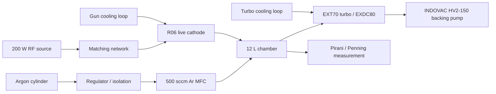
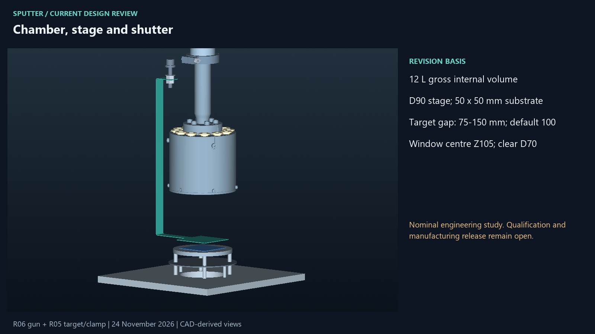

# System architecture

The adjustable magnetron points down toward a fixed substrate stage inside a nominal 12 L chamber. The gun passes through a top KF25 compression gland. A bent rotary shutter interrupts the line of sight during conditioning. The front door loads the substrate and carries a D70 viewport.

This diagram records selected subsystem relationships. Isolation/vent hardware, wiring and controls are not a completed P&ID or electrical schematic. No roughing bypass is selected.

## Coordinates and interfaces

System coordinates are X right, Y rear and Z up, with origin at the internal floor centre. The closed door faces negative Y. Gun-only CAD uses the historical source coordinate system, with the target pointing +Y. Do not directly overlay gun-only and system files without their placement transform.

| Interface | Nominal frozen basis |
|---|---|
| Chamber interior | 200 × 200 × 300 mm |
| Shell / roof / floor | 10 mm nominal; final structural qualification pending |
| Door | 228 × 316 × 16 mm; loading opening 180 × 270 mm |
| Window | Clear D70, centre X0 / Z105 |
| Top gun port | Centred KF25, mating face Z330 |
| Bottom pump connection | Centred ISO63-K, chamber mating face Z−45 |
| Rear gas port | KF25, X0 / Z210 |
| Rear gauges | KF25 at X−50 / Z90 and X+50 / Z90 |
| Right spare ports | KF25 at Y0 / Z75 and Z225, blanked |
| Shutter shaft | X−65 / Y0, nominal D6.8 hole; sealing details unresolved |
| Stage / substrate | D90 × 6, stage top Z40; substrate top Z41 |
| Target plane | Default Z141, 100 mm above substrate; 75–150 mm gap range |

Use [Frozen chamber interfaces.csv](../chamber-design/chamber-supplier-package/Frozen%20chamber%20interfaces.csv) and [R04 dimension schedule](../chamber-design/main-system-r04/Dimension%20schedule.csv) for the detailed schedules. R05/R06 changes override older target/fitting dimensions.

## Operating concept and design scope

The intended process introduces regulated argon into an evacuated chamber. A magnetized discharge sputters the aluminium target, and material reaches the substrate when the shutter opens. The documented magnetic field does not simulate the discharge or deposition. The current views omit simulated plasma particles to avoid implying an operating or deposition result.

The selected RF source uses a matching network. A DC variant would require its own compatible electrical implementation and would bypass that RF matching topology. Current procurement is the RF selection. The panel enclosure and cables shown in CAD do not constitute a released wiring design.
