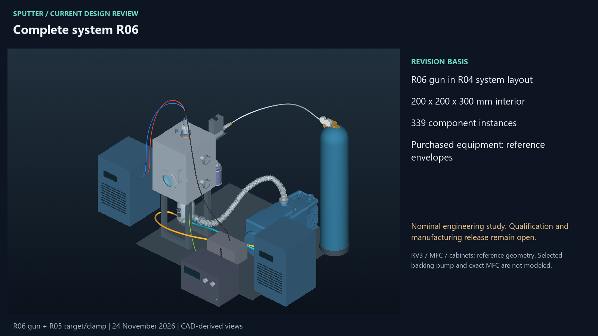
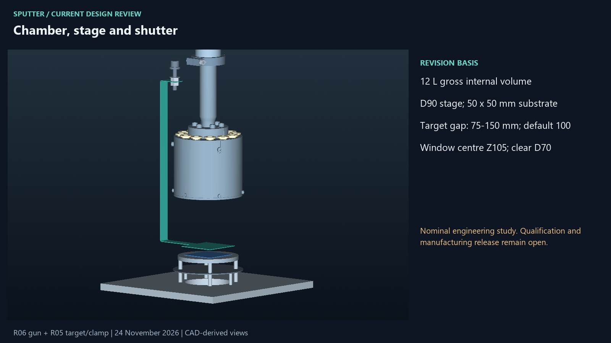
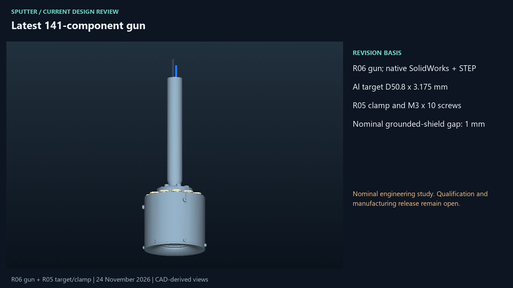
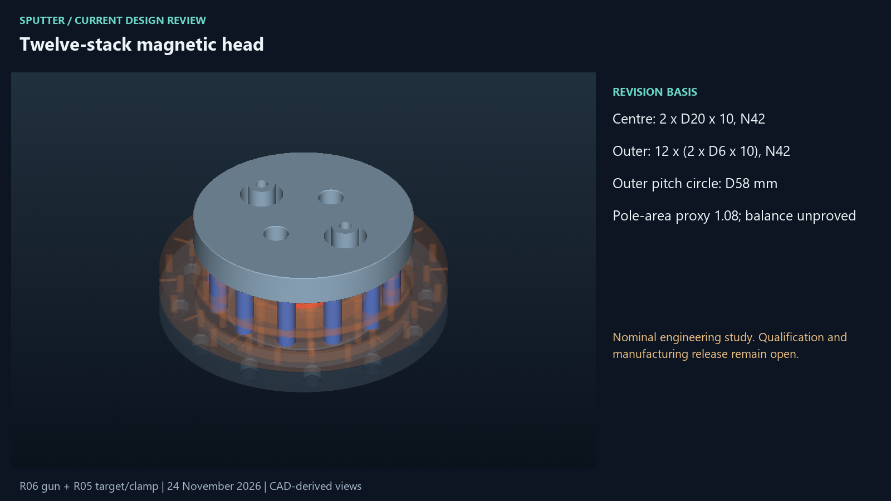
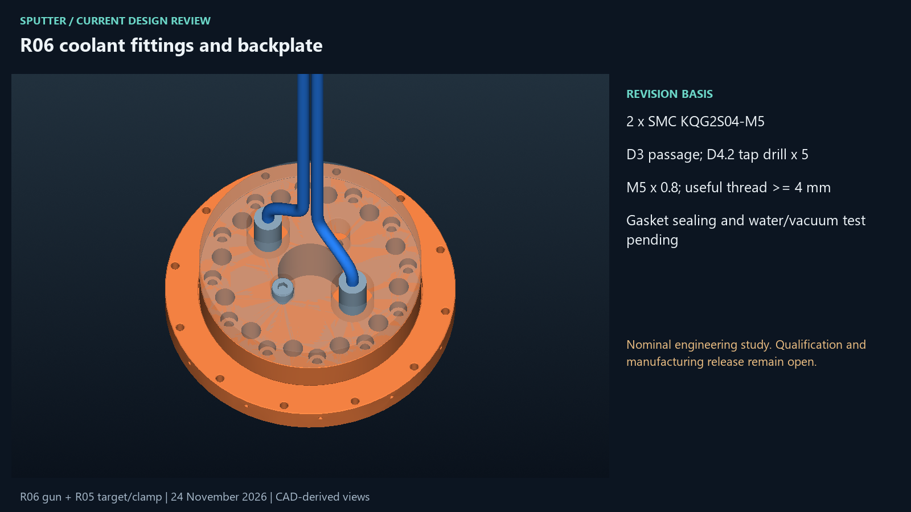

# Current design explanations

All videos and CAD stills in this library were generated from the latest R06 system STEP for the 24 November 2026 snapshot. The magnetic plot uses the current 3.175 mm target-plane assessment. Old walkthrough segments are not reused. [provenance.json](provenance.json) records source hashes and synthetic narration details.

| Video | Subjects | Transcript |
|---|---|---|
| [01 Current system](01-current-system.mp4) | Whole system, internal chamber/stage/shutter, pumping and gas selections | [Text](01-current-system-transcript.txt) |
| [02 Current gun](02-current-gun.mp4) | R06 gun, twelve-stack magnets, R05 target/clamp, R06 M5 ports | [Text](02-current-gun-transcript.txt) |
| [03 Current field and evidence](03-current-field-and-evidence.mp4) | Updated field assessment and remaining qualification | [Text](03-current-field-and-evidence-transcript.txt) |

MP4 files have English synthetic narration and switchable English subtitle tracks. Individual chapter MP4/SRT files are also retained. Some GitHub clients require opening/downloading the raw video. These are explanatory CAD animations, not footage of physical hardware or a validated running machine.

## Current stills

Copper transparency and hidden chamber context reveal internal parts. Views retain actual R06 part positions. The RV3 reference, MFC housing and cabinet geometry remain subject to the documented selection mismatches. No rendered photo is presented as an as-built record.

To reproduce: `python tools/build_current_media.py`. See [reproduction guide](../docs/reproducibility.md) for dependencies and native narration requirements.
