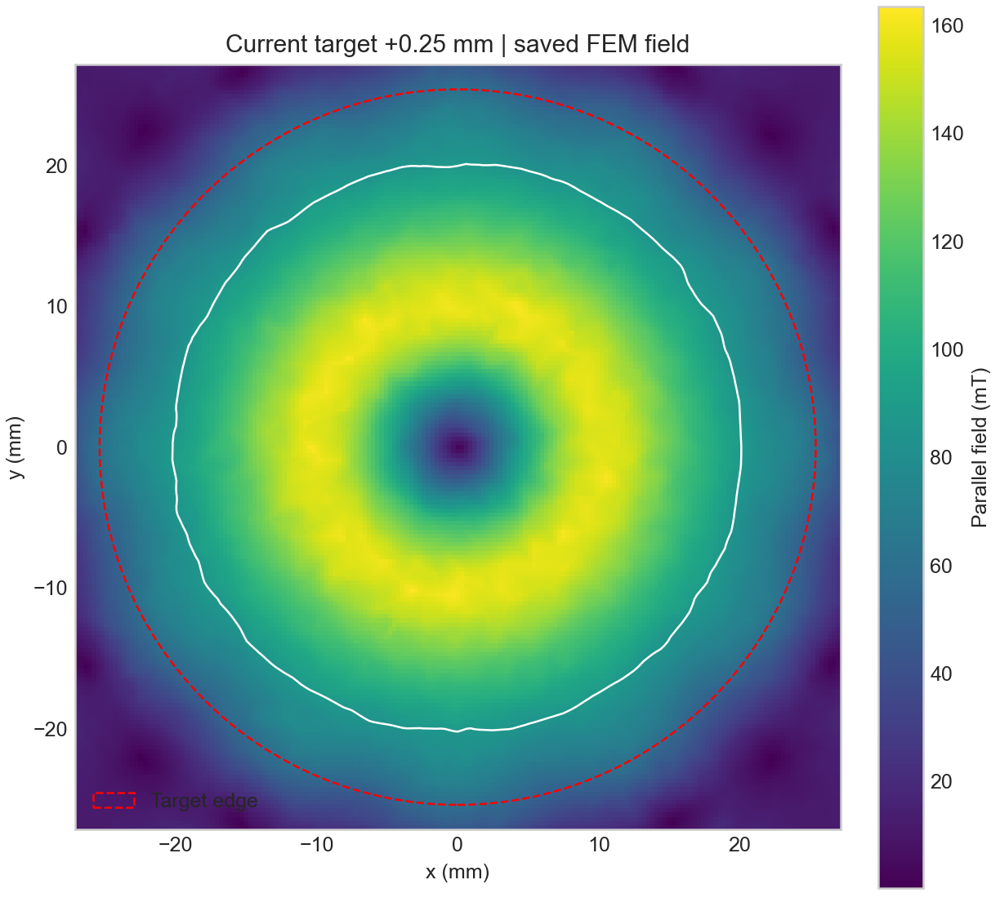
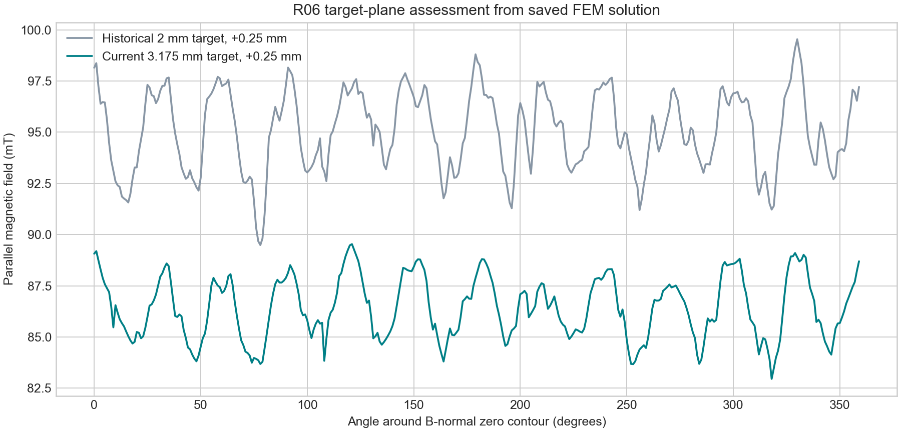

# Current target-plane magnetic assessment

Current gun R06 retains the magnetic circuit and uses the R05 D50.8×3.175 nonmagnetic target. The pole-to-front spacing is 5.675 mm. [assessment.json](assessment.json) records a sample at 0.25 mm above that face, simulation Z3.425, using the retained refined nonlinear FEM solution.

**Calculated mean parallel field: 86.429 mT**, range 82.955–89.535 mT. The B-normal zero contour crosses all 360 sampled angles, with mean radius 20.194 mm. [racetrack.csv](racetrack.csv) contains the samples.

## Method and applicability

The [resampling script](../../tools/reassess_current_field.py) loads the original `fine_nominal_field.npz` using the original VTK field-probing method. It samples 469 radii per angle, locates the first sign-changing B-normal crossing and linearly interpolates the radius and parallel vector. It first reproduces the original 2 mm-target mean within 0.05 mT, then samples the current plane.

No new mesh or nonlinear solve is performed. This is appropriate within the saved model because the retained magnets/yoke are unchanged and target/copper/fittings are μr=1. Real ferromagnetic fittings or different material properties would require a revised magnetic problem. The field file SHA-256 is recorded in the report. Original mesh/analytical checks are retained but not newly established uncertainty bounds at this plane.

This is magnetic-strength screening. It does not certify ignition, balanced topology, plasma confinement time, deposition, erosion, temperature or a power rating. Compare with a calibrated field map above the actual target before relying on the prediction. See [full simulation evidence](../../docs/simulations.md).
