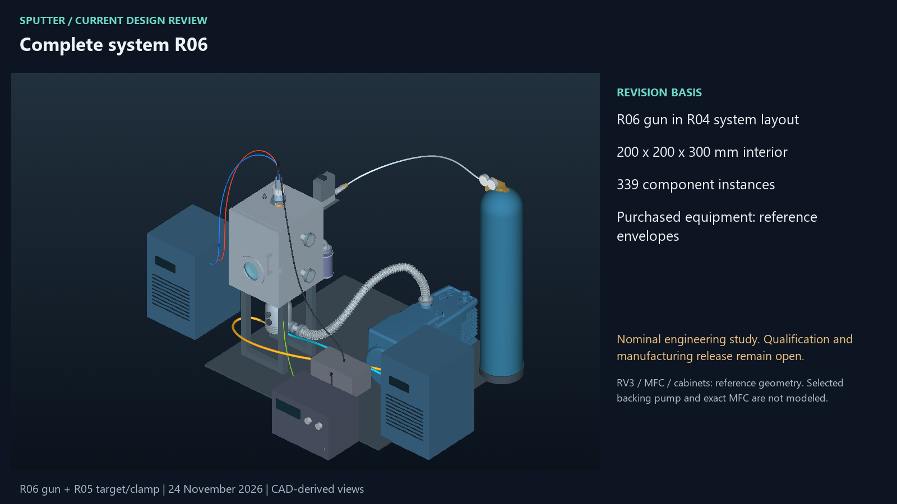
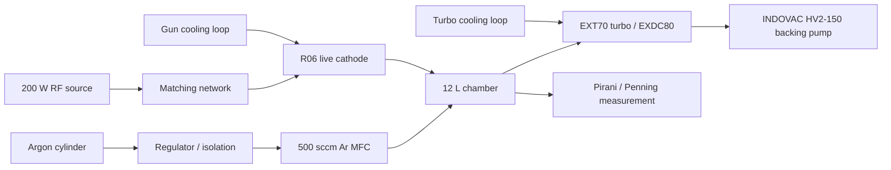
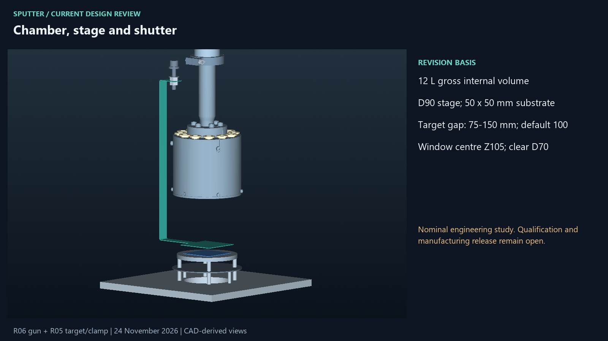
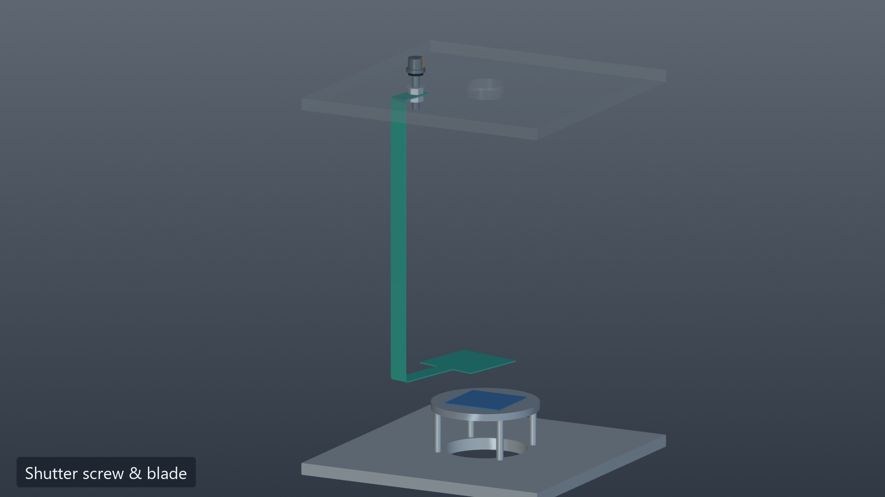
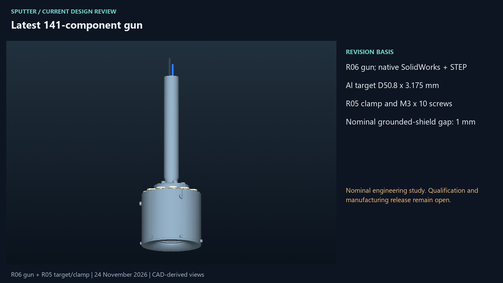
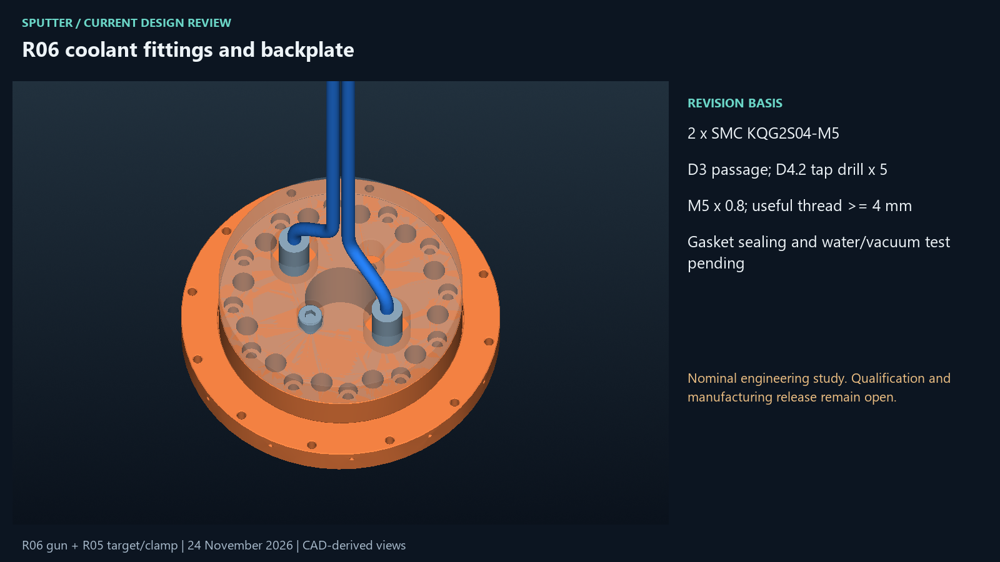
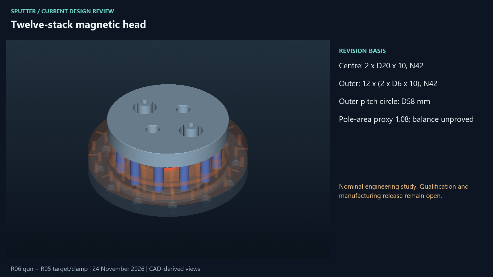
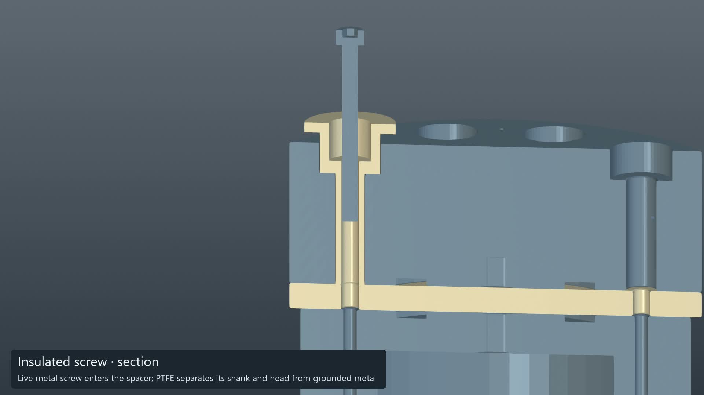
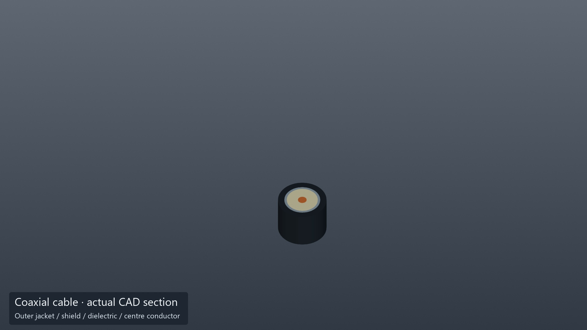

# System architecture and CAD

[System layout](#system-layout) · [CAD downloads](#cad-downloads) · [Current walkthroughs](#current-walkthroughs) · [Chamber and shutter](#chamber-and-shutter) · [Gun and services](#gun-and-services) · [Dimensions and editing](#dimensions-and-editing)

This is the home for the system explanation and its CAD files. For a first look, download the **complete system STEP** below; the standalone gun and manufacturing packages are separate deliverables for specific jobs.

| Folder | What belongs here |
|---|---|
| [models](models/README.md) | Current complete-system and gun CAD, native gun package, dependent parts and geometry checks |
| [manufacturing](manufacturing/README.md) | Chamber supplier handoff and stage/shutter fabrication packages |
| [sources](sources/README.md) | Supporting R04 layout and R05 target/clamp work used to produce the current assembly |
| [references](references/README.md) | Component selection, supplier/interface evidence and build scripts |

## System layout

The gun points down toward a fixed substrate stage in a nominal 12 L chamber. A top-mounted KF25 compression gland supports gun-height adjustment. The hinged front door provides sample access and carries the viewport. The shutter controls when the substrate is exposed to material from the target.

Argon enters through a regulator and mass flow controller. The chamber is evacuated through the turbo and its backing pump. RF power reaches the gun through a matching network; the gun and turbo have independent cooling loops.

## Current specifications and selections

| Item | Current basis |
|---|---|
| Chamber interior | 200 × 200 × 300 mm; 12 L gross |
| Target | Al 99.99%, D50.8 × 3.175 mm; VritraTech selection |
| Target/substrate gap | 75–150 mm adjustment; 100 mm default |
| Stage / substrate | D90 × 6 mm / 50 × 50 × 1 mm |
| Magnetic circuit | 2 × D20 × 10 N42 centre; 12 outer stacks of 2 × D6 × 10 N42 on PCD58 |
| Gun coolant fitting | 2 × SMC KQG2S04-M5; gasket sealing remains to qualify |
| Pumping selection | Chamber → EXT70 / EXDC80 → INDOVAC HV2-150; direct foreline |
| MFC selection | STEC SEC-4400MC-G2; Ar 500 sccm; calibration/interfaces to verify |
| RF source selection | Omicron 200 W supply + matching network; provisional procurement basis |

The [procurement guide](../procurement/README.md) holds the planning budget and sourcing details. Full design reasoning and the distinction between CAD, calculations and measured performance are in [Engineering and simulations](../docs/engineering.md).

## CAD downloads

| Deliverable | Scope |
|---|---|
| [Complete R06 system STEP](models/Complete%20sputter%20system%20R06.step) | Standalone system context with latest gun |
| [Magnetron R06 STEP](models/Magnetron%20R06.step) | Standalone neutral gun geometry |
| [SolidWorks R06 package ZIP](models/Coolant%20fittings%20R06%20-%20SolidWorks%20CAD%20package.zip) | Native gun assembly and dependent parts |
| [CB01 supplier handoff](manufacturing/chamber/CB01%20supplier%20handoff.zip) | Frozen chamber scope and CAD reference, not approved manufacturing drawings |
| [Stage/shutter fabrication package](manufacturing/stage-and-shutter/Stage%20and%20shutter%20-%20local%20fabrication.zip) | Separate fabricated stage and bent shutter references |

For a first look, download the complete-system STEP. For gun editing in SolidWorks, download the native ZIP so its dependent parts stay together. The [component register](../design/current-component-register.csv) identifies the 141 gun instances. [Current selections and revision boundaries](../docs/current-design.md) explain which artifacts govern the design.

## Current walkthroughs

| Walkthrough | What it shows |
|---|---|
| **[Complete system — 3:59, silent](../media/assembly-walkthrough/Sputter%20R06%20-%20silent%204%20minute%20walkthrough%20v2.mp4)** | 37 assembly and operating-cycle views. Uses the corrected shutter motion: screw, nuts, washer and blade turn together; the compressed O-ring stays stationary. |
| **[Complete gun — 3:53, silent](../media/gun-complete-walkthrough/R06%20sputter%20gun%20-%20slower%20compact%20walkthrough.mp4)** | All 60 gun views in a compact edit, including R05 target/clamp, R06 coolant fittings, PTFE insulation and corrected coax-layer views. |

For slower inspection, the [full-length gun walkthrough — 17:47, silent](../media/gun-complete-walkthrough/R06%20sputter%20gun%20-%20complete%20silent%20walkthrough.mp4) uses the same corrected gun picture sequence. All 141 component instances are accounted for in the [coverage register](../media/gun-complete-walkthrough/component-coverage.json).

These existing exports show the latest recorded mechanical and animation corrections. Purchased equipment remains the source CAD's representative geometry; current procurement selections are stated on this page. Older narrated system reviews and earlier shutter exports are excluded from this reading path. GitHub may require downloading the MP4 to play it.

## Chamber and shutter

The chamber interior is 200 × 200 × 300 mm. The default target-to-substrate distance is 100 mm, adjustable from 75 to 150 mm. The D90 stage supports the reference 50 × 50 mm substrate; the bent shutter interrupts its line of sight to the target during conditioning.

| Chamber interior | Shutter and stage |
|---|---|
|  |  |

Walls are hidden or transparent to expose interfaces. The shutter image comes from the corrected complete-assembly rotation review, rather than an earlier screw-only motion illustration.

## Gun and services

The removable target is D50.8 × 3.175 mm aluminium. Its clamp seats it against the copper cooling body. The grounded shield surrounds the head, while the service tube carries the coaxial cable and two coolant hoses through the top mounting gland.

| Assembled gun | Cooling connections |
|---|---|
|  |  |

The R06 backplate uses two SMC KQG2S04-M5 coolant fittings. Target contact, coolant sealing and RF/thermal performance still require qualification; the renders show nominal geometry.

### Magnetic circuit and electrical isolation

Two D20 × 10 mm N42 centre discs face twelve outer stacks, each containing two D6 × 10 mm N42 discs on PCD58. A steel yoke provides the return path. PTFE separates live and grounded structures, including the individual screw shoulder sleeves.

| Magnetic head | Insulated screw section |
|---|---|
|  |  |

The section explains the modeled insulation arrangement; it does not establish electrical clearances, breakdown performance or seal compression. The [magnetic assessment](../docs/simulations.md) describes the calculated field and its limits.

### RF connection

The coax centre conductor connects through a ring terminal and stand-off to the live copper head. The shield connects through its spring clamp and carrier to the grounded body. The cable's dielectric separates these paths.

Final connector mapping, grounding, shielding and commissioning checks remain separate from the mechanical CAD. The selected RF supply is 200 W; that selection is not a qualified gun power rating.

## Dimensions and editing

Coordinates and interface dimensions

### Coordinates and interfaces

System coordinates are X right, Y rear and Z up, with origin at the internal floor centre. The closed door faces negative Y. Gun-only CAD uses the historical source coordinate system, with the target pointing +Y. Do not directly overlay gun-only and system files without their placement transform.

| Interface | Nominal frozen basis |
|---|---|
| Chamber interior | 200 × 200 × 300 mm |
| Shell / roof / floor | 10 mm nominal; final structural qualification pending |
| Door | 228 × 316 × 16 mm; loading opening 180 × 270 mm |
| Window | Clear D70, centre X0 / Z105 |
| Top gun port | Centred KF25, mating face Z330 |
| Bottom pump connection | Centred ISO63-K, chamber mating face Z−45 |
| Rear gas port | KF25, X0 / Z210 |
| Rear gauges | KF25 at X−50 / Z90 and X+50 / Z90 |
| Right spare ports | KF25 at Y0 / Z75 and Z225, blanked |
| Shutter shaft | X−65 / Y0, nominal D6.8 hole; sealing details unresolved |
| Stage / substrate | D90 × 6, stage top Z40; substrate top Z41 |
| Target plane | Default Z141, 100 mm above substrate; 75–150 mm gap range |

Use [Frozen chamber interfaces.csv](manufacturing/chamber/Frozen%20chamber%20interfaces.csv) and [R04 dimension schedule](sources/system-layout-r04/Dimension%20schedule.csv) for the detailed schedules. R05/R06 changes override older target/fitting dimensions.

Opening and editing the native CAD

Dimensions are millimetres. Download the native ZIP or clone the entire repository before opening SolidWorks. Opening an isolated SLDASM from the GitHub web interface will omit its dependencies. Keep all native part files beside the assembly. The saved reopen/reference checks establish the original package state; after relocating, allow SolidWorks to resolve same-folder components if the original absolute search paths appear.

The native gun assembly contains fixed components. It does not provide editable assembly mates or a motion mechanism. Many components are imported solids. The R06 backplate has native cut-extrudes for the revised passages/tap drills; thread callouts/custom properties carry the M5 specification. Threads are nominal envelopes, not helical teeth.

Supplied geometry and SolidWorks checks

### Checks supplied with R06

- [Geometry checks](models/Geometry%20checks.json): no new non-thread overlaps among the changed parts; intentional thread-envelope intersections are classified.
- [Native backplate independent check](models/Native%20backplate%20independent%20check.json): revised bore geometry matches expected geometry.
- [Native export check](models/Native%20assembly%20export%20check.json): 141 valid gun solids and small volume difference from reference.
- [Native reopen and reference check](models/Native%20assembly%20reopen%20and%20reference%20check.json): original saved package component references.
- [SolidWorks verification](models/SolidWorks%20verification.json): native import validity and per-part volume comparisons.

Read these as nominal geometry checks. They do not certify manufacturing tolerances, useful thread engagement, gasket compression, fatigue, leak integrity or thermal performance.

